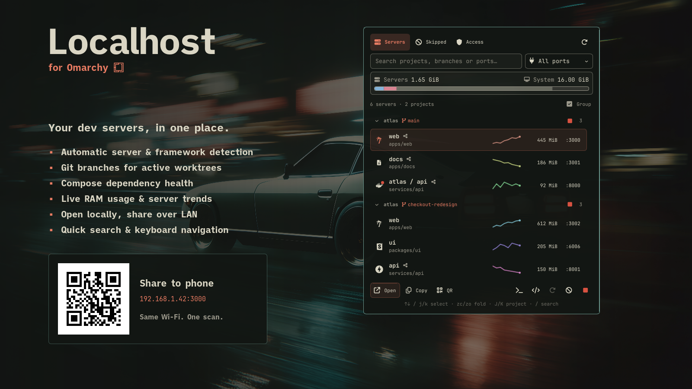

# Localhost for Omarchy

[](https://github.com/tcballard/omarchy-badges)

Find your running dev servers in the Omarchy bar. Open the right worktree in
your browser, see what’s using RAM, or scan a QR code to try a change on your
phone. Localhost discovers native HTTP and HTTPS servers and published Docker
ports automatically.



Preview theme and wallpaper by Erik Johansson. [Motion Blur](https://github.com/erikrjohansson/omarchy-motion-blur-theme) · [Credits](THIRD_PARTY_NOTICES.md)

## Install

Localhost runs on Omarchy 4 / Quattro with the Quickshell bar.

```bash
omarchy plugin add https://github.com/EmilsValdmanis/omarchy-localhost.git --enable
```

Start your dev server as usual, then click the Localhost icon on the right side
of the bar. The icon appears when a server is detected. To keep it visible
between projects, enable **Show when no servers are running** in the plugin settings.

## Find a server

Servers are grouped by project. When you run two worktrees of the same
repository, their headers show the branch names. Press `/` to search by branch,
project, or port. Use the arrow keys or `h/j/k/l` to move and `Enter` to act.
Hover over a project in the RAM bar to see its total. Each server row shows its
own RAM history.

Discovery tries `HEAD /` first. If the server rejects that request, Localhost
tries `GET /health`, then `OPTIONS *`. It reuses the selected request for
periodic checks and native restarts. Rate limits and temporary server errors
also confirm HTTP without triggering more requests in the same scan. If all three
return errors, the server still appears. Automatic checks then use just the
first responding target. A manual refresh can try the alternatives again.
Probes use the `omarchy-localhost` user agent.

- **Docker Compose** — Hover over the Docker icon to see the service and its
  dependencies, including databases with private ports. A dot flags a problem.
  If the container listing exceeds 256 KiB, Localhost uses the complete rows
  within that limit and shows a warning that discovery is incomplete.
- **Stop all** — Stops the whole project in one click, including servers hidden
  by a search or fold. Hover over the button to see how many it will stop.
- **Skipped** — Look here if a server is missing or you want to restore one
  you hid. Skipping an identified service follows it when its port changes.
- **Restart logs** — If a restarted native server fails to start serving requests,
  use **Open log** to read its output in your editor, even after its row disappears.

## Try it on your phone

Connect the phone to the same Wi-Fi as your computer. Start the server on a LAN
address and select **QR** in Localhost. For Vite, use the `--host` flag.

```bash
pnpm exec vite --host 0.0.0.0
```

If **QR** is disabled, check whether the server is listening only on
`127.0.0.1` or `::1`. If UFW blocks the connection, Localhost can authorize
the port for your subnet. Manage those rules under **Access**.

## Optional keyboard shortcut

Add this binding to `~/.config/hypr/bindings.lua` to toggle the panel from
anywhere. Choose another key combination if this one is already in use.

```lua
o.bind("SUPER + SHIFT + L", "Localhost", "omarchy-shell emils.localhost toggle")
```

## Uninstall

Remove any firewall rules you added through **Access** before removing the plugin.

```bash
omarchy plugin remove emils.localhost
```

[Release notes](https://github.com/EmilsValdmanis/omarchy-localhost/releases) · [Contributing](CONTRIBUTING.md) · [Security](SECURITY.md) · [MIT license](LICENSE)
